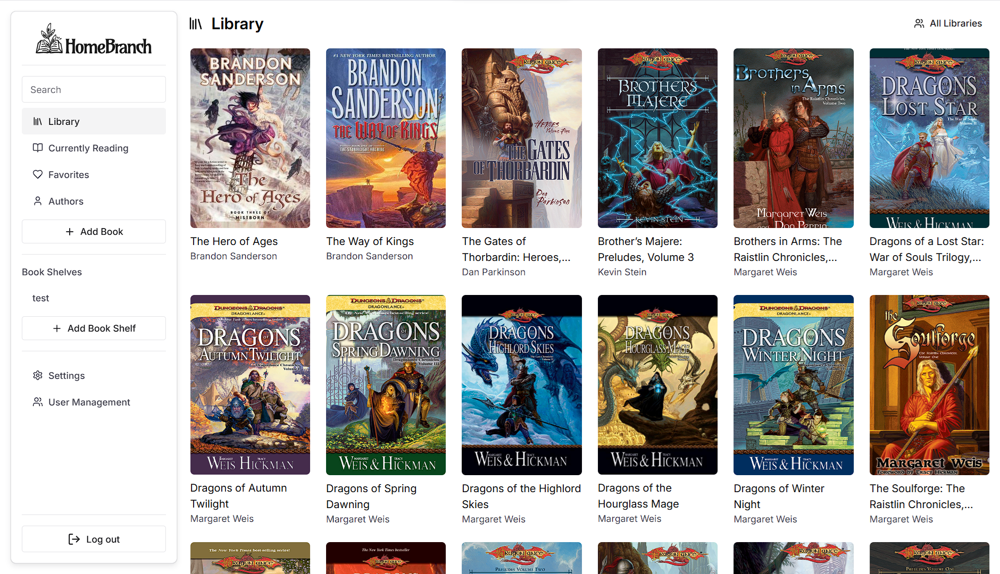
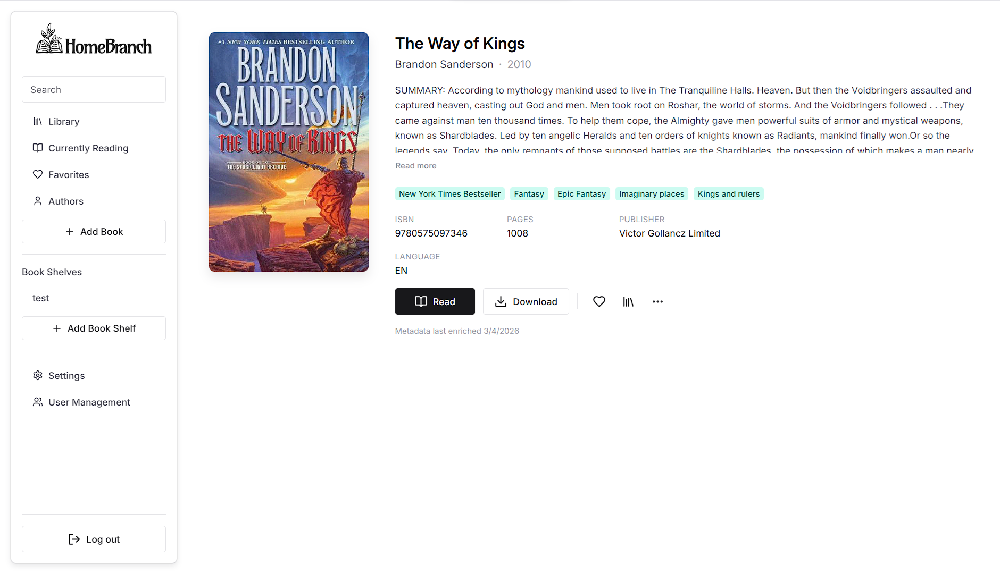
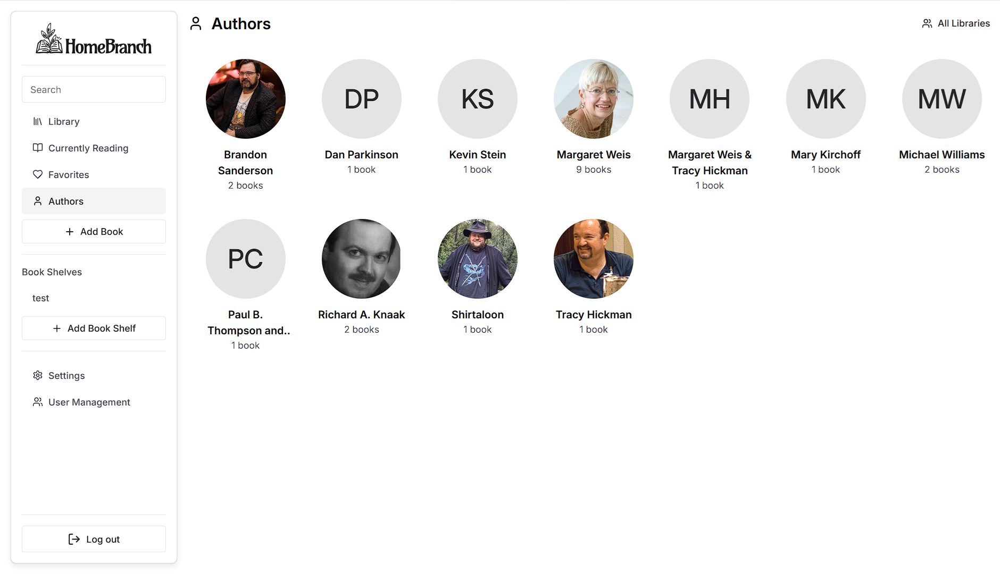

# NMQ — an open-source ebook library frontend

**NMQ** واجهة ويب مفتوحة المصدر لتنظيم الكتب الإلكترونية وقراءة ملفات EPUB وPDF. المشروع مبني على [HomeBranch](https://github.com/Oghamark/homebranch-web)، ويحتاج إلى خدمتي المكتبة والمصادقة لتشغيل الحسابات والكتب. يركّز تطوير هذه النسخة على موثوقية التشغيل، وتحسين التسجيل ومعالجة الأخطاء، وتسهيل مساهمة المطورين.

NMQ is an early-stage React and TypeScript frontend for a self-hosted ebook library, maintained in [alshawshfras3-cmd/nmq](https://github.com/alshawshfras3-cmd/nmq). It builds on the HomeBranch frontend and retains its AGPL-3.0 license and upstream attribution.

This repository contains the web interface. A working installation also needs a compatible library API and authentication service. The current interface and artwork retain HomeBranch branding; NMQ-specific maintenance is recorded in this repository's [commits](https://github.com/alshawshfras3-cmd/nmq/commits/main/) and [pull requests](https://github.com/alshawshfras3-cmd/nmq/pulls?q=is%3Apr).

## What the application provides

- EPUB and PDF reading in the browser, with saved reading positions.
- Library search, metadata filters, book details, and author views.
- Shelves, favorites, and a currently-reading list.
- Book uploads and administrative library management through the library API.
- Account registration, login, user roles, and optional OIDC through the authentication service.
- Light and dark themes, an installable PWA, and a cached application shell.
- Live library and job updates through server-sent events.

Book storage, metadata processing, user authorization, and synchronization depend on the backend services. The cached application shell does not make every book available offline.

## Components

| Component | Repository | Responsibility |
| --- | --- | --- |
| NMQ frontend | [This repository](https://github.com/alshawshfras3-cmd/nmq) | Browser interface, readers, and requests to the backend services |
| HomeBranch library API | [Oghamark/homebranch](https://github.com/Oghamark/homebranch) | Book storage, metadata, collections, and library operations |
| Authentication service | [Oghamark/Authentication](https://github.com/Oghamark/Authentication) | Accounts, cookie-based authentication, token refresh, and optional OIDC |

The frontend's main branch uses the HomeBranch authentication service. Supplying a Supabase URL and key alone does not provide the API contract that this frontend expects. See the backend repositories and the [upstream installation documentation](https://homebranch.app/docs/getting-started/) for their setup.

## Local development

### Requirements

- Node.js 24 and npm.
- A running HomeBranch-compatible library API and authentication service, with their own storage and configuration prepared.

### Setup

```sh
git clone https://github.com/alshawshfras3-cmd/nmq.git
cd nmq
npm ci
cp .env.example .env
```

Set the service addresses in `.env`. For services running on the example local ports:

```dotenv
VITE_API_ROOT=http://localhost:8080
VITE_AUTHENTICATION_ROOT=http://localhost:3000
VITE_API_URL=/api
VITE_AUTHENTICATION_URL=/auth
VITE_ITEMS_PER_PAGE=20
```

Start the frontend:

```sh
npm run dev
```

Open the address printed by Vite. During development, Vite forwards `/api/*` requests to `VITE_API_ROOT` and `/auth/*` requests to `VITE_AUTHENTICATION_ROOT`, removing the respective prefix. Adjust the root URLs to match your actual services.

### Configuration

| Variable | Purpose |
| --- | --- |
| `VITE_API_ROOT` | Library API target for Vite's development proxy |
| `VITE_AUTHENTICATION_ROOT` | Authentication target for Vite's development proxy |
| `VITE_API_URL` | Library API base URL used by the browser; use `/api` with a same-origin proxy |
| `VITE_AUTHENTICATION_URL` | Authentication base URL used by the browser; use `/auth` with a same-origin proxy |
| `VITE_ITEMS_PER_PAGE` | Number of items requested per library page |
| `VITE_SIGNUP_ENABLED` | Set to `false` to hide the signup route in the frontend; the authentication service must enforce its own registration policy |

Variables prefixed with `VITE_` are build-time frontend configuration and may be exposed in the browser bundle. Keep server credentials in the backend services, and keep `.env` out of Git.

### Verification

```sh
npm test
npm run typecheck
npm run build
```

The production frontend is generated in `build/client`. Automated tests and a successful build check frontend behavior; account creation, cookies, uploads, and reading synchronization also need verification against running backend services.

## Deployment

The frontend builds as a single-page application. Deploy `build/client` with a fallback to `index.html` for application routes.

For the current cookie-based authentication, a same-origin reverse proxy can route `/api/` to the library API and `/auth/` to the authentication service. The included Nginx template uses `API_BACKEND` and `AUTH_BACKEND` for those targets and maps the authentication refresh-cookie path.

The included `vercel.json` configures the frontend build and application-route fallback. **Vercel does not start the library API or authentication service from this repository, and Vite's development proxies do not run in the production build.** Configure production service routing separately. If the browser uses absolute service URLs, both services must permit the frontend origin and support the required credentialed requests and cookie settings.

Rebuild the frontend after changing its `VITE_*` configuration. Verify registration, login, logout, token refresh, a book upload, and reopening a saved reading position against the deployed services before announcing an installation as ready.

## Contributing

Open issues and pull requests in [this repository](https://github.com/alshawshfras3-cmd/nmq), targeting `main`. See [CONTRIBUTING.md](CONTRIBUTING.md) for the workflow and checks. Reports are useful when they include the affected commit, reproduction steps, and whether the problem occurs in the frontend or a backend service.

## Interface previews

The screenshots below show the inherited HomeBranch interface.

<picture>
  <source media="(prefers-color-scheme: dark)" srcset="images/library_view.png">
  
</picture>
<picture>
  <source media="(prefers-color-scheme: dark)" srcset="images/book_details_view.png">
  
</picture>
<picture>
  <source media="(prefers-color-scheme: dark)" srcset="images/authors_view.png">
  
</picture>

## License and attribution

- Source code is provided under [GNU AGPL-3.0](LICENSE).
- NMQ is based on [HomeBranch Web by Oghamark and its contributors](https://github.com/Oghamark/homebranch-web). Its original library and reading features come from that project; NMQ's changes are tracked separately in this repository.
- "HomeBranch" Logo and Iconography © 2026 [Acro Visuals, L.L.C.](https://acrovisuals.com) is licensed under [CC BY-SA 4.0](https://creativecommons.org/licenses/by-sa/4.0/).

<picture>
  <source media="(prefers-color-scheme: dark)" srcset="public/Logo%202-Color%20For%20Dark.svg">
  
</picture>
